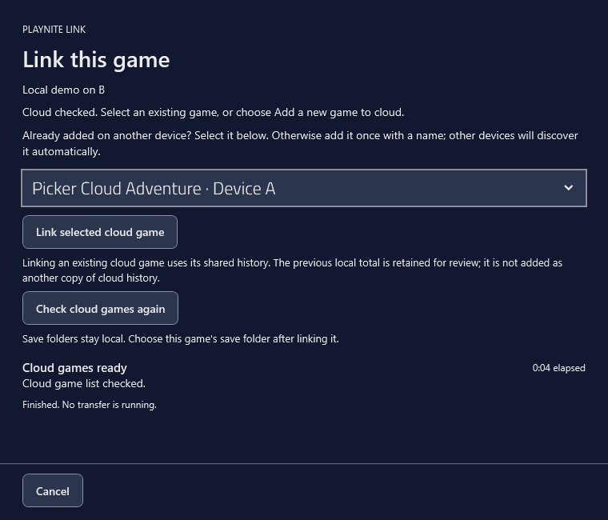
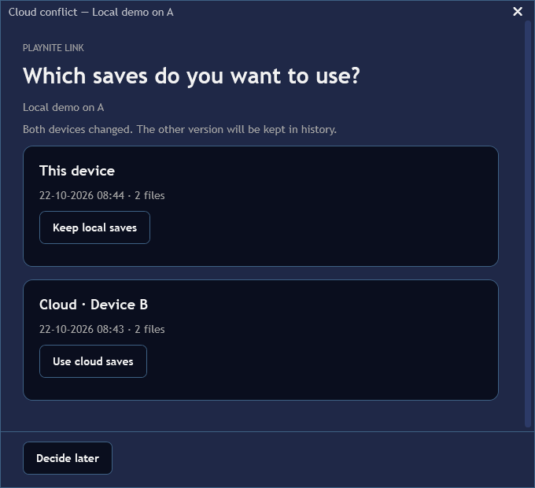

# Playnite Link

Sync game saves and playtime between Playnite devices using your own cloud storage.

**[Download Playnite Link 0.7.2](https://github.com/metanmai/playnite-link/releases/tag/v0.7.2)** · Windows 10/11 · Playnite 10 · .NET Framework 4.8

## Get started

1. Open the downloaded `.pext` in Playnite and restart when prompted.
2. Open **Playnite Link** from the sidebar or main menu and connect your storage. On your second device, sign in to the same storage account and choose the same vault folder. See the [Google Drive setup guide](docs/GOOGLE-DRIVE.md) if you use Drive.
3. Right-click a game and choose **Playnite Link → Link game…**. Add the game once, then select that existing cloud entry on the second device. To sync saves, configure the game's save paths on each device.

## Play on either device

Playnite Link checks configured saves before launch and queues local changes when you quit. Let the upload finish before switching devices. Open **Cloud sync…** for a game's status, or choose **Sync now** to check the whole linked library.

If both devices changed the save, review the versions and choose **Keep local saves**, **Use cloud saves**, or **Decide later**. Open **Save manager…** to manage backups and restore earlier saves.

Steam and Epic games use their launcher for saves by default. Use one sync tool per save folder. The game-card cloud badge requires a compatible Playnite theme.

## Optional achievements

Install [Playnite Achievements](https://github.com/justin-delano/PlayniteAchievements) separately on each device and enable **Synchronize achievements** in Link. In 0.7.2, use **Sync now** on the receiving device. Our PC-to-ROG Ally test confirmed manual receipt and persistence after restart. Automatic receipt while idle failed.

## More information

- [Features and settings](docs/PRODUCT.md) · [Technical details](docs/TECH.md) · [Testing](docs/VALIDATION.md)
- [Report an issue](https://github.com/metanmai/playnite-link/issues) · [License](LICENSE) · [Third-party notices](THIRD-PARTY-NOTICES.md)

Playnite Link is an independent add-on. Save data stays in your chosen vault. Storage credentials stay on each device.
