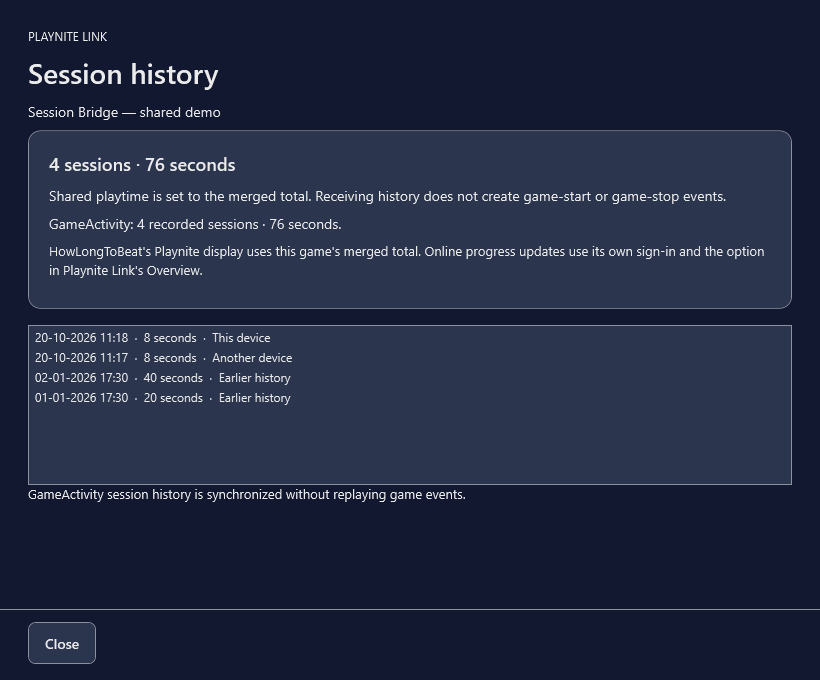

# Playnite Link

Your saves and playtime, in your own cloud storage.

An independent community extension for **Playnite 10.62+ on Windows 10/11**. There is no Playnite Link account server or central save database. Each device authorizes your storage account separately.

[Download 0.5.1](https://github.com/metanmai/playnite-link/releases/latest) · [Setup guide](https://fluffy-florentine-e76038.netlify.app/playnite-link/setup.html) · [Report an issue](https://github.com/metanmai/playnite-link/issues)

## Install

1. Download the `.pext` file from the latest release.
2. Open it with Playnite, approve installation, and restart Playnite.
3. Open **Playnite menu → Playnite Link → Personal cloud account & settings**.
4. Connect an existing authorized Rclone remote, or create a supported provider connection. Use the same vault folder on your other device.

Playnite is currently holding new plugin submissions. A validated catalog contribution is prepared as a draft until submissions resume. Until it is merged, use the release download above. Once listed, installation and updates will also be available through **Add-ons → Browse → Generic**.

## What it does

- Save synchronization with explicit conflict choices, immutable cloud history, local restore backups, and streamed large-file support.
- Immutable playtime/session records that merge without adding the same session twice.
- GameActivity history integration and consistent Playnite play counts/totals.
- Optional updates to an existing mapped online HowLongToBeat profile entry. Updates set absolute progress and preserve lists, scores, completion fields and greater online progress.
- Device roster and per-device synchronization controls.
- Optional extension/theme installation sharing. Active themes, Playnite settings, addon settings and sign-ins remain local.
- Optional local app-wide passcode.
- Background synchronization. Ordinary game launches do not wait for cloud access; remote save replacement is deferred during play. Known conflicts still require review.



## Storage and setup requirements

Existing Rclone configurations are supported. New-account connections support Google Drive, Dropbox and OneDrive. An existing Rclone executable is reused, or a pinned official runtime is downloaded and checksum-verified.

**Google Drive currently requires your own Desktop OAuth client JSON** when creating a new connection. This avoids relying on Rclone's shared Google project quota. No personal developer OAuth client, token or account is distributed. See [Google Drive setup](docs/GOOGLE-DRIVE.md). Dropbox/OneDrive do not use this Google setup.

Fresh profiles automatically link unambiguous library-provider identities. Manually added games and ambiguous duplicate identities need review. Save folders need a local selection on each device; the extension does not guess arbitrary save paths. Only choose dedicated game-save folders.

GameActivity 3.7 and HowLongToBeat 3.13 were tested. Online HLTB updates need an independent local HLTB sign-in and an existing correctly mapped profile entry. Missing online entries are not created automatically, preventing duplicate creation races. Other addons are optional.

## Timing and validation

Tested with two actual Playnite instances in Desktop and Fullscreen modes, both addons enabled, and a real Google Drive vault. Measured game launches during background cloud work took 571 ms and 464 ms; warm cloud metadata checks took approximately four seconds. Large transfers, provider outages and manual conflict decisions have different durations.

**201 automated checks passed**, including session idempotence, save-conflict handling, launch-during-staging safety, passcodes, addon rollback and metadata filtering. Repeated synchronization and restart retained consistent totals. See [acceptance evidence](docs/ACCEPTANCE.md). Tests simulate two devices using isolated Windows profiles; they do not claim physical ROG Ally validation.

## Build and contribute

Install Playnite 10.62+ and .NET Framework 4.8, then run:

```powershell
pwsh -NoProfile -ExecutionPolicy Bypass -File ./build.ps1
pwsh -NoProfile -ExecutionPolicy Bypass -File ./package.ps1
```

Tests and isolated host harnesses are in `tests/`. Cloud tests require your own authorized Rclone configuration and must use a dedicated synthetic vault prefix. Never run test helpers against a personal production library.

Release packaging must contain no cloud configuration, tokens, passcode state, personal saves or test-companion binaries. [Privacy](https://fluffy-florentine-e76038.netlify.app/playnite-link/privacy.html) · [Third-party notices](THIRD-PARTY-NOTICES.md) · [MIT license](LICENSE).
